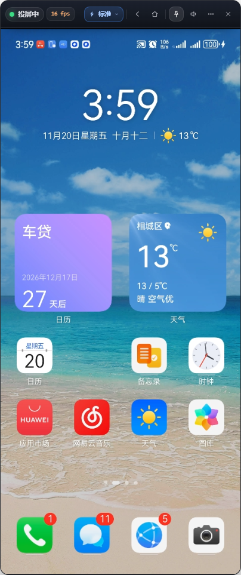

# dsh-miniwin — phone screen mirroring inside the DSH sidebar

English | [中文](README.md)

Scan a QR code in the DSH sidebar and the phone screen opens in a transparent
desktop mini-window. No IP, no port, no browser tab: the picture travels over
scrcpy's H.264 stream through adb and is decoded straight into a native window.



## What it is (and what it is not)

Three surfaces, easy to mix up:

1. **The sidebar panel** — shows the QR code, pairs the phone, starts and stops
   the session. It never draws the picture.
2. **The desktop mini-window** — the actual phone screen. Always-on-top,
   draggable, eight-way resize, independent content and background opacity.
3. **The phone** — either the bundled APK (scan the QR to download it) or a
   zero-install pairing page served by the plugin itself.

The picture never enters the browser, so the DSH web UI stays at full frame rate.

## Requirements

- Windows 10/11 (the bundled scrcpy build and its DLLs are Windows binaries)
- An Android phone with USB debugging enabled, on the same LAN as the PC
- `dsh` 0.1.0 or newer

Nothing else: adb, scrcpy and the scrcpy-server jar ship inside `runtime/`.

## Install

```sh
dsh plugin --profile web add dsh-miniwin
```

From a checkout instead:

```sh
dsh plugin --profile web add link:<path-to-this-repo>
```

Restart the host, then open the **手机投屏** panel in the sidebar.

## Layout

```
lib/                 host side (Cordis plugin: routes, pairing, session control)
lib/client.js        browser side (the sidebar panel)
runtime/             the mirroring runtime, shipped with the plugin
  main.js            mini-window Electron entry
  ui.html preload.js the window itself
  scrcpy-capture.js  named-pipe MKV reader → H.264 frames
  wifi-receiver.js   audio + video receiver for the APK path
  tools/scrcpy/      adb.exe, scrcpy.exe, scrcpy-server
  apk/miniwin.apk    optional phone-side sender (audio)
cordis.patch.yml     bundle patch: mounts the host half into the profile
```

`runtime/` is resolved at load time: `MINIWIN_HOME` (development) first, then the
bundled directory. The mini-window reuses the host's own Electron through
`process.execPath`, so the package does not carry a second 200 MB runtime.

## Environment overrides

| Variable | Purpose |
|---|---|
| `MINIWIN_HOME` | point at a different runtime directory instead of the bundled one |
| `MINIWIN_ELECTRON` | use a specific `electron.exe` when the host is not Electron |
| `MINIWIN_NODE` | node used for the receiver child process |
| `MINIWIN_ADB` | adb used for device discovery |

## Known limits

- Windows only. The transport is adb over USB/WiFi; the bundled binaries are win32.
- One phone per host at a time.
- MediaProjection-based audio needs the bundled APK; without it only the picture is mirrored.

## License

MIT. The bundled scrcpy and platform-tools binaries keep their own licenses —
see `runtime/tools/scrcpy/scrcpy-win64-v5.0.1/LICENSE.txt`.
